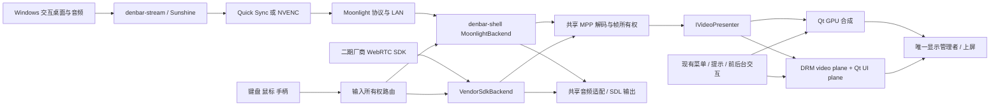

# Denbar 两端串流集成设计

日期：2026-10-27，修订 2。服务端采用用户已确认的 C++23 + Sunshine 轻量 Fork；客户端直接集成到 denbar-shell，生产链路采用 moonlight-common-c + MPP。Qt 合成与 DRM/KMS 视频/UI 双图层在一期开始时并列验证。本文定义一期局域网的实现边界，并保留二期厂商 SDK 接入点。硬件性能需要独立验收，仓库准备完成不代表串流功能已经实现。

## 1. 项目与基线

| 项目 | 位置 | 基线与职责 |
| --- | --- | --- |
| denbar-stream | `E:/VisualStudioProjects/denbar-stream`；GitHub `TangChengLin/denbar-stream` | Sunshine Fork；C++23；Windows x64 采集、编码、发送、输入注入及管理 |
| denbar-shell | `E:/QtProjects/denbar-shell`；原 Cursor 远程 | Qt Quick 6.8.3、C++17、Linux ARM64；common-c 接收、MPP 解码、音频、视频呈现、外设与现有 Qt UI |

本次源码核对基线：Sunshine `d0b4a88ef727f8dabf80cc970a14739b55c885de`；denbar-shell 本地 master `214abf23acda2960bc05dd63bbaf020bd5a5fa2f`。客户端 origin fetch 在本轮因 SSH 公钥认证失败；本地 origin/master 与 master 相同，但不能据此声称远程最新。

服务器以该 Sunshine 提交作为开发基线，不把 master 标签当发布资格。正式版本需要通过本文验收后记录精确 commit、子模块和依赖清单。已发现的官方正式版 `v2026.914.233613` 可作为对照，不能把它的文件行号、测试清单与当前 master 混用。

两个仓库从各自 master 建立 `codex/denbar-stream-integration`。设计与计划保存在 `docs/superpowers/`，本轮只准备仓库和文档。两端 C++ 标准彼此独立，不共享编译后的 C++ ABI。

## 2. 目标与范围

- 一期公司有线 LAN，Windows 主机适配 Intel UHD 730、Nvidia RTX 30 和 RTX 50 的实际设备；一台主机同一时刻只允许一个活动串流连接。
- 产品目标为 2560×1440、240 个不同视频画面每秒、显示输出 240Hz，包含音频、键盘、相对鼠标和手柄。软件兼容与性能达标分别报告，低档联调不代替 240 验收。
- PC 云电脑【开始】是一期真实生产入口。保留现有游戏中菜单、剩余时间提示、返回本地桌面、继续/恢复和退出交互；现有 TV 与 visual-state 夹具不回归。
- 一期使用 HEVC Main、8-bit、4:2:0、SDR 作为共同高帧率候选；H.264 作为兼容档，不能默认承诺同样吞吐。HDR、AV1、多用户 GPU 分租、USB 透传、麦克风上传不进入一期。
- 二期由厂商 Linux ARM64 SDK 负责 WebRTC 会话和公网传输，回调编码媒体；denbar-shell 复用本地媒体与 UI。denbar-stream 不承担该二期厂商链路的服务器功能。

## 3. 方案取舍

| 方案 | 取舍 | 决策 |
| --- | --- | --- |
| 独立管理程序 + Sunshine 二进制 | 引擎升级简单，直接修改采集编码需要另建下游 | 曾考虑，未选 |
| Sunshine 轻量 Fork | 能维护实际编码选择、诊断、安装及兼容补丁；承担上游合并成本 | 用户已选 |
| 重写 Windows 采集、编码、传输栈 | 可控范围大，重复实现配对、输入、丢包恢复和设备兼容 | 不选 |

客户端采用仓内 MoonlightHostClient + moonlight-common-c + MPP，协议、解码和呈现分离，不另建客户端仓库。common-c 提供串流核心，主机配对、应用发现和 launch/resume 仍由客户端适配层承担。两种呈现方案均保留现有 Qt UI，并由唯一显示管理者协调。

| 客户端组件/路线 | 用途与取舍 | 决策 |
| --- | --- | --- |
| common-c + 直接 MPP | 接入现有会话/输入/UI；显式控制解码缓冲、同步和生命周期 | 生产主链路，用户已确认 |
| Qt GPU 合成 | MPP DMA-BUF 导入 EGLImage 后进入 Qt 场景图，便于现有菜单、透明和效果参与合成 | 前置验证，是否达标以真板结果决定 |
| DRM/KMS 视频/UI 双图层 | 视频 DMA-BUF 直上 video plane，Qt 输出 ARGB UI plane；可能减少 GPU 视频合成，但需要显示平台集成 | 与 Qt 合成同时前置验证，不等后期性能失败再开始 |
| moonlight-embedded | 独立运行的协议、MPP/DRM 播放对照，帮助区分服务器/解码/Qt 集成问题 | 仅测试工具；不嵌套进 denbar-shell，不作为生产播放器 |
| ffmpeg-rockchip | 封装 MPP 和 DRM_PRIME，适合独立多媒体管线；此项目暂不需要额外封装层 | 暂不纳入客户端生产依赖，也不新增其 submodule |

直接使用 MPP 不等于天然比 FFmpeg 封装少一帧延迟；双图层也不等于天然实现 240fps。两者都必须测吞吐、排队、同步和实际呈现，不能仅凭 API 路径宣布“零拷贝达标”。

## 4. 总体链路

## 5. Windows 服务端

### 5.1 上游复用与构建

保持现有 `src/platform/windows/`、`src/video.cpp`、`src/nvenc/`、`src/audio.cpp`、`src/nvhttp.cpp`、`src/rtsp.cpp`、`src/stream.cpp` 和输入层。配对、证书、协议、加密与 FEC 沿用上游。一期不修改 Moonlight 线协议。

遵循仓库 AGENTS：Windows 使用 MSYS2 UCRT64、CMake、Ninja，构建目录 `cmake-build-*`；当前主 C++ 标准为 23，第三方/CUDA 保留其自身要求。Qt 和原生 Node.js 跟随所选上游依赖，不强制客户端的 Qt 6.8.3，也不预设 MSVC 已受支持。

复用上游服务安装与交互会话捕获方式；一期服务捕获基线 `capture=ddx`。不让自有 Session 0 服务直接采集交互桌面。锁屏、注销、显示器拔插均产生明确状态，恢复时重新验证输出和编码设备。

### 5.2 最小新增模块

新增 `src/denbar/profile.{h,cpp}`、`session_policy.{h,cpp}`、`diagnostics.{h,cpp}`，必要接缝修改保持小范围。管理能力复用 `src/confighttp.cpp` 现有认证/CSRF 保护与现有 Vue 管理界面；不另建管理网络服务。

Profile 独立存储为 `denbar-profiles.json`，schemaVersion=1。字段包含 id、revision、capture、encoder、adapterName、outputId、requireHardware、allowExperimental、allowedModes。allowedModes 每项为 codec、width、height、fps、maxBitrateKbps、qualification（Experimental/Verified）、qualificationId 的完整组合。encoder 值为 `quicksync` 或 `nvenc`，不是 `qsv`。id 唯一；尺寸、fps、码率必须为正且在候选范围内；未知字段/版本明确拒绝。应用 profile 时生成 Sunshine 已支持的配置字段，不能把所有 profile 字段原样写入 sunshine.conf。

参数权威明确分层：profile 决定采集设备、编码器与允许的媒体组合；客户端在允许组合中提出具体 codec/width/height/fps/bitrate 请求。尺寸与帧率必须精确命中一项 allowedModes，码率不超过该项上限；launch 和 RTSP 协商分别校验它们所含的参数，全部通过才激活 lease。冲突、过期能力清单或编码器实际结果不匹配时明确拒绝，不覆盖客户端选择，也不静默降档。重启成功仅表示配置载入，不能当作后续请求或性能已通过。

一期能力清单通过服务端管理界面导出无密钥的 host-profile.json（schemaVersion、hostId、profileRevision、allowedModes），部署到客户端 SettingsStore；地址由安装配置提供，配对证书单独管理。它用于设置项过滤和启动前校验，服务端仍是最终权威；不让客户端持有服务器管理密码，不为此改变 Moonlight 线协议。过期清单导致拒绝时提示更新配置；后续可以另加经过认证的能力同步接口，但不属于一期必要链路。

profileRevision是本地配置关联与诊断字段，不假定Moonlight请求携带它。客户端可拒绝请求与本地清单revision不一致；服务端依据当前allowedModes校验实际协商参数。旧清单中的组合仍被服务端允许时可以连接，只有实际冲突才拒绝；不能声称在不扩展协议的情况下比较了两端revision。

一期开关配置只允许在无 pending/active 会话时应用：申请配置事务锁、验证、暂存、原子保存并受控重启；重启失败可恢复上一个配置。配对、凭据与会话状态文件不能被配置覆盖。与 launch/resume 共用 admission 锁，避免“检查空闲后又接入新会话”的竞争。

初始联调档位为 1080p60、1440p120；目标档为 1440p240，码率调试起点建议 100000 Kbps（100 Mbps），再按画质和网络实测调整。所有数值都是请求值；只有测量记录匹配主机、驱动、输出和客户端能力后，240 档才标为已验证。

候选档位最初均为Experimental，验收环境可以显式启用allowExperimental来测试，界面始终标记未验证。正式部署默认false，只开放Verified且附qualificationId的组合。这样允许对240做首次端到端测试，同时不把可选档位等同于已通过性能验收。

GPU/显示选择复用 `display_device` 与 DXGI 发现。现有 adapter_name 是描述字符串，不冒称是稳定唯一 LUID；若同名设备无法确定则报告歧义，不静默猜测。配置的显示、渲染 GPU、采集 GPU、实际编码器分别记录。UHD 730 可用硬编不代表能以 240fps 渲染目标游戏。

上游指定 encoder 探测失败后可能自动选择其它编码器。一期 Denbar 严格硬编模式必须核对实际结果：指定硬编不可用即明确拒绝，不把软件回退报成成功。NVENC/Quick Sync 调参沿用现有选项，低延迟目标为避免重排序和长前瞻，以实际输出验证。

### 5.3 单活动流与恢复

新增线程安全 admission lease，状态为 idle → reserved → active → idle。launch/resume 在改变显示/应用前取得 lease；RTSP 成功后转 active；失败、握手超时、取消、断连和停止全部释放且幂等。当前上游不存在可直接解决此需求的 channels=1 配置，不能只查询 session_count 后放行。

连接断开后远端桌面/游戏可继续运行，但传输 lease 释放。恢复必须以已配对身份重新获得 lease 并复用应用，另一客户端占用时返回 busy，不自动抢占或取消对方应用。一期的 quit 表示停止本地流，不调用关闭远端应用或 Windows 关机。

### 5.4 部署和同步上游

origin 为用户 Fork，upstream 为官方 Sunshine。保留历史、许可证和第三方声明；Denbar 模块独立，避免全树替换 Sunshine 名称。升级放在 `codex/sync-sunshine-*` 分支，合并选定提交、更新固定子模块、重新验证再发布；不自动部署移动的 master。

安装包应检测已有 Sunshine，避免相同服务、端口和配置同时运行。一期采用单实例部署；发现冲突时提示管理员处理，不覆盖既有配对资料。发布包记录 publisher、版本、二进制哈希、驱动/输入依赖、回退步骤。当前上游 libvirtualhid 最低 broker 版本为 2026.914.1218.10，键鼠/手柄功能按实际驱动组合验收。

## 6. denbar-shell 客户端

### 6.1 代码接缝

`PcCloudPage.startRequested` 经 WindowFrame、WindowManagerLayer 到 PcMain，再调用 GameSessionVM/StreamingController。当前外层缺少 startRequested 转发；生产入口不得调用带假时长的 fixture start。

GameSessionVM 继续是 QML 会话门面；SessionVM 是认证对象，不承担串流状态。新增 `src/streaming/` 内部库；StreamVideoItem 注册到现有 Denbar.Common，GameSessionVM 仍归现有 viewmodel 模块，遵守单次 moc 和 QML 注册约束。

MoonlightHostClient 负责主机地址/发现、配对证书、应用列表、launch/resume；MoonlightBackend 负责 common-c 会话、媒体与输入。初期使用配置的 host 地址和从应用列表获取的 Desktop appId，不硬编码 appId。配对 PIN 通过上游配对界面完成；客户端保存自身身份和配对服务器证书，后续连接验证身份，不能全局忽略 TLS 错误。

### 6.2 会话、预算与后台

内部状态 Idle/Connecting/Playing/Reconnecting/Stopping/Failed；每次开始生成新的 generation。所有回调带 generation，迟到回调不得复活已取消会话；重复开始幂等。stageVisible 与 running 分离，使 Connecting 时可创建视频节点并提交首帧，避免“未 running 不渲染，未渲染又不能 running”的死循环。首个有效呈现回调后才进入 Playing；Qt frameSwapped 只能证明提交/交换，物理上屏时刻另测。

GameSessionVM 保留 running/foreground、resume/background/quit 及既有提示接口；新增 connectionState、stageVisible、errorText、budgetKind、hasRemainingTime。生产无额度时为 Unlimited 或 Unknown，不能用 0 秒触发退出；Finite 以单调时钟截止时间推进，默认低余额阈值仍为 1800 秒。二期以厂商额度更新为准。

| 状态/操作 | 视频音频 | 输入与会话 |
| --- | --- | --- |
| 连接中 | 加载层，允许底层完成首帧准备 | 可取消，远端输入关闭 |
| 前台播放 | 最新视频、音频 | 原始输入发远端，保留本地菜单快捷键 |
| 游戏菜单打开 | 视频继续、保留现有叠层 | releaseAll；菜单独占本地输入 |
| 返回桌面 | 持续消费码流/解码参考帧；不提交隐藏画面；默认静音 | 原连接保持，计时继续，本地桌面接收输入 |
| 继续 | 立即取最新可用画面，恢复音频 | 原连接恢复输入，不重新 launch |
| 退出/超时 | 停止媒体并清理缓冲 | 先释放远端输入，再断开；不关闭远端游戏 |

菜单关闭或恢复时，仍按住的键、按钮、偏离中位的摇杆先等待释放/回中，避免双投递与粘键。网络断开时本地记账清零，服务端清理注入状态；重连建立新的 transport generation，远端应用连续性和传输连接连续性分开记录。

TV/PC 形态切换会重启进程，与“返回桌面”不同。活动流切换前保存不含密钥的 ResumeDescriptor（hostId/appId/预算引用），释放输入、停止呈现并等待 GPU 引用，沿用现有 GL 停放门禁。停放失败不 spawn、不退出且恢复原呈现；成功后断开旧流释放 lease，再启动子进程，由子进程认证并 resume 原应用。启动失败父进程尝试恢复同一应用；不把失败误报成无缝恢复。密钥仍留受权限保护的配对存储。

一期时间与资源策略：连接超时10秒、传输连接后首帧超时5秒；重连按1/2/4秒退避（后续封顶4秒），总窗口30秒，取消立即终止。退出清理5秒仍未完成则显示失败并保留仍在使用的资源，不能强制释放/分离活线程或启动竞争的播放进程。压缩队列上限8个AU，溢出进入等待关键帧的解码epoch；关键帧请求限频250ms；显示候选容量2，PCM队列上限40ms。ResumeDescriptor单次消费、有效60秒，保存Linux bootId及CLOCK_BOOTTIME绝对截止点，同一boot内预算不重置，跨boot拒绝旧描述符。

### 6.3 媒体管线

所有接入层输出完整编码 access unit、codec、参数集/配置、时间戳、关键帧标识和缓冲所有权。SDK 回调返回后可能失效的内存必须在返回前复制或持有厂商允许的引用，不保存悬空指针。RTP 包、NAL 片段和完整帧不能混用。

MPP 独立解码线程；info-change 时重新分配/确认缓冲组；按 MPP/DPB 要求管理引用，不把整个解码池限制成两张。压缩队列有界，溢出或损坏时请求关键帧并重同步，不任意删除参考帧。显示候选采用容量 2、最新优先；GPU 或显示控制器使用中的帧保持引用直到相应使用完成，不能被解码器覆写。

共享 `DecodedFrame` 包含 generation、frameId、时间戳、尺寸/裁剪、fourcc、每平面 fd/stride/offset、modifier、色彩矩阵/范围、可用的 acquire 同步和资源 lease。资源由引用与同步共同约束；不能只传一个 fd。`IVideoPresenter` 接收帧、处理激活/停放/恢复并报告提交或已呈现证据，Moonlight 和未来厂商 SDK 不感知呈现实现。

前置验证两条真实板端路径，先做可独立运行的最小验证程序，再将通过的路径产品化；不等待完整会话、配对和 C5 产品组件完成：

| 路径 | 数据流 | 必须证明的条件 |
| --- | --- | --- |
| `qt-composite` | MPP DMA-BUF → EGLImage → Qt Quick OpenGL/GLES 材质 → Qt 窗口 | 可导入实际 fourcc/modifier；正确 YUV 色彩；真实菜单/提示/效果参与合成；GPU 完成前持帧；实测帧率、延迟和 GPU/内存带宽 |
| `drm-planes` | MPP DMA-BUF → DRM framebuffer/video plane；Qt 渲染 → ARGB UI plane；同一显示管理者提交 | 实际 CRTC/plane 的格式、modifier、alpha、z-order、缩放、带宽及 atomic test/commit 通过；Qt UI 透明正确；视频和 UI 不互相覆盖；输入焦点与停放/恢复正确 |

两条路径先以线性 NV12 作为兼容候选，实际可用格式以 MPP 输出和 EGL/KMS 共同支持为准；不强开 AFBC/RFBC，不把 Rockchip RFBC 当作 ARM AFBC。压缩格式不被消费端支持时，显式选择已验证的线性输出或报告不支持；任何 RGA/格式转换或额外复制都单独记录成本，不能藏在“零拷贝”指标中。目标是无 CPU 逐帧 YUV→RGB 和 QImage 上传，并不声称完全没有编码数据复制或 GPU 合成。

实际 QPA、EGL 扩展和显示模式在板端探测后写入部署清单。已有 Wayland 时 compositor 唯一拥有 KMS，双图层必须通过 compositor 已验证的 plane 分配能力或明确的平台扩展实现；EGLFS 时由 Qt 平台集成协调两个 plane，必要时开发单独的设备集成插件。只开启 EGLFS atomic 模式不会自动得到双图层。不得在普通 QML Item、独立播放器或第二个 DRM master 中竞争同一 CRTC，也不能靠固定 `/dev/dri/card0`、plane id 或 zpos 猜测硬件。

Qt 合成路径需等 GPU 读取结束才释放源帧；KMS 路径需保持当前 scanout 帧，直到后续替换/禁用提交完成后才释放。提交成功或该帧第一次 page-flip 不能作为释放当前 scanout 的依据。报告区分 submitted、compositor/KMS presented 和物理显示；无可信回执时保留 unknown。

返回本地桌面时，Qt 路径隐藏视频节点，双图层路径由同一 owner 禁用视频 plane 并等待退役，不能只停止提交而留下旧视频遮挡桌面；Qt 桌面/UI继续正常显示。接收与解码仍持续，恢复时只提交最新可用帧。形态切换则进一步完成整个显示资源停放，失败不启动竞争进程。

Qt UI 若需要对视频做实时背景模糊，外部 video plane 不会自动成为 Qt 取样源。保留现有菜单与效果契约：先核对实际取样关系，确需视频背景时使用受控的 Qt 合成回退或经验证的 GPU 共享取样；必须测切换帧连续性和代价。不得悄悄取消模糊/透明、冻结背景或隐藏菜单来宣称达标。

选择规则由本设计确定：同一 BSP、码流、模式和 UI 场景分别测两条路径。两条均满足目标时优先维护成本较低的 Qt 合成；仅双图层满足时选择双图层并承担显示集成维护；两条均未满足时记录 240 未通过，低档只继续联调。选定后写入 `presentation-baseline.json`，包括 QPA、显示 owner、backend、格式、依赖指纹和资格报告；构建/部署不静默切换。生产只强制交付选定路径及其必要回退，不强制维护两个完整播放器。

GameStageLayer 保持 overlayHost 与提示/菜单层，替换视频底层；fixture 模式仍可显示 PosterImage。PointerShield 与输入过滤协同，避免视频点击穿透桌面，同时不吞掉远端应收到的鼠标。

一期音频使用 common-c 的 Opus 回调、libopus、已有 SDL2 音频输出（48kHz 双声道基线），避免为此引入 QtMultimedia。播放队列有界；短时缺包用解码器补偿/静音，后台持续消费但静音，恢复不播放陈旧积压。SDK 若输出 PCM 则绕过解码器；输出其它编码必须显式实现/拒绝，不能假定均为 Opus。

### 6.4 原始输入与设置

现有 GamepadWorker 只向 UI 暴露方向语义，需增加 deviceId + 全量模拟轴/按钮原始快照，沿用唯一 SDL 事件线程；不另启竞争 SDL consumer。键盘使用物理键映射和明确的重复策略，排除 UI 合成事件。相对鼠标从实际平台获取未被屏幕边界截断的 delta；Wayland 使用其相对指针/约束能力，EGLFS 使用同一平台输入适配，不以光标坐标差假装无限相对移动。权限和能力由板端探测确定。

InputRouter 管 UI，StreamingInputRouter 管远端；InputOwnership 为 Local/Remote，切换前 releaseAll。一期一只活动手柄，保留现有设备切换规则，热拔插释放远端状态；多手柄扩展另议。

SettingsVM 增加 1440p 和 240fps，并区分请求档位、协商档位、实测吞吐与输出刷新率。用户请求超出能力时明确提示，不静默把 120 冒充 240。帧率/丢包 OSD 统计真实层级；UI 统计更新限频到 2Hz，不按 240Hz 更新 QML 文本。

### 6.5 依赖固定与 submodule 管理

下表是后续实施时的依赖策略；本次仅更新设计和计划，没有给客户端添加 submodule、安装 MPP 或构建测试工具。“候选固定提交”用于开始可复现的集成，不等于已经通过 RK3576 性能验收。

| 依赖 | 固定版本/来源 | 管理与发布规则 |
| --- | --- | --- |
| Sunshine 服务端 | `d0b4a88ef727f8dabf80cc970a14739b55c885de` 开发基线 | 整仓轻量 Fork；沿用该父提交的全部递归 gitlink，现有 47 个已初始化；不是把 Sunshine 再作为服务器 submodule |
| 客户端 moonlight-common-c | 初始候选 `04053843c90c4268583f2496b997d54d59f03957`，与已克隆服务器中的版本一致 | 必选 submodule：`third-party/moonlight-common-c`；嵌套 enet=`aca87840b57f045a1f7f9299e4b1b9b8e2a5e2f1`、nanors=`b1e3c22ca0cdc0bb83e3cd6ed1a2fc77869ed99a`；递归初始化并记录实际树 |
| Rockchip MPP | 优先目标板 BSP 配套的头文件、`librockchip_mpp` 和内核驱动组合；确切版本尚待真板提取 | 默认 `DENBAR_MPP_PROVIDER=system`，由冻结的目标 sysroot/部署包供给，不新增 submodule；锁定包版本、源码提交（可获得时）、构建选项和库/头文件 SHA-256。缺少这些证据不得标记生产基线完成 |
| 自行构建 MPP（仅确有需要） | 从已验证兼容该 BSP 的提交派生，提交号在引入前写入锁文件 | 互斥选项 `DENBAR_MPP_PROVIDER=source`；可选 submodule `third-party/rockchip-mpp`。只链接/部署一种 MPP，不覆盖系统库、不混用新版头文件和旧运行库；与现有 libmpv 等共享依赖存在冲突时先解决后启用 |
| Qt | 精确 `6.8.3`，保留现有版本断言 | 沿用现有工具链；额外固定 Qt 构建配置、QPA/设备集成插件及补丁哈希；不再嵌一份 Qt 源码 submodule |
| libdrm、GBM/EGL/GLES、Mali、内核/DTB/固件 | 与 BSP 和已选 QPA 配套的确切包/镜像 | 用 sysroot/镜像摘要、包版本和文件哈希固定，不能独立自动升级到 latest；不批量引为源码 submodule |
| libopus、现有 SDL2、主机控制所需 TLS 库 | C0 提取目标环境精确版本，C3/C6 固定新增包来源及哈希 | 复用项目包/工具链机制并纳入锁文件，不重复拉 SDL 事件循环或无目的添加源码仓库 |
| moonlight-embedded | 测试候选 `f32e415aea6797d261d6b470dcf8bf18727341c2` | 可选测试 submodule：`tools/streaming/reference/moonlight-embedded`，递归依赖跟随其父 gitlink；独立构建/进程，默认产品构建和安装包排除，不链接其 `libmoonlight-rk.so`；它自己的 common-c 不与产品 common-c 混链 |
| ffmpeg-rockchip | 不选生产版本 | 暂不增加 submodule、链接或部署依赖；后续若需要先修改设计并验证。此决定不删除 Sunshine 既有 FFmpeg 或客户端现有 libmpv/FFmpeg 依赖 |

上游 MPP `20959ec3dabb313b8c33ca0b7b09c06ffd2a9caa` 的 RK3576 SoC 表仅作为源码研究依据，不是目标板生产版本。SDK 和 BSP 未提供的真实版本不得填成该研究提交或“最新”。

客户端 C0 建立 `toolchain/streaming/dependencies.lock.json`，schemaVersion=1。每项记录 role（production/reference）、provider（submodule/package/bsp）、repository/commit 或包版本与 SHA-256、许可证来源、构建选项和 qualification 状态；板端部分记录 BSP/内核/sysroot/Qt/QPA/MPP 实际加载库。`sourceCommit` 不可得时明确 unknown，仍须有不可变的包/镜像和文件哈希，不能伪造来源。开发待取证项可以显式 unresolved，但发布检查拒绝生产项 unresolved。服务器 S1 独立记录本端依赖清单；两端通过 runId 和清单摘要关联，不共享 C++ ABI 或强求全部依赖同版本。

submodule 规则：

1. `.gitmodules` 记录官方 HTTPS URL，父仓 gitlink 固定完整提交；子模块工作树保持干净，不用移动分支/tag 作为发布锁，不在常规构建执行 `git submodule update --remote` 或联网拉 latest。
2. 客户端生产初始化按路径执行 `git submodule update --init --recursive third-party/moonlight-common-c`；选择 source MPP 时才初始化其路径。对照工具另行显式初始化其路径，默认构建/打包不依赖它。服务器按上游树初始化全部既有子模块。
3. CI/发布检查所需路径的 `git submodule status --recursive`，拒绝未初始化、偏离或冲突状态，并核对锁文件；自有补丁放在依赖 Fork 的可获取提交，或维护有校验的补丁集，不依赖未提交修改。
4. 升级在独立 `codex/deps-*` 分支进行；服务器同步上游用 `codex/sync-sunshine-*`。一次只推进有明确目的的依赖组，提交 gitlink、锁文件、兼容报告和回退点；不得仅因服务器升级就强制同步客户端 common-c。
5. common-c 升级重跑配对/协议/AU/输入/重连；MPP/BSP/Qt/DRM 升级重跑 G0 双路径和 G3；工具升级重建对照基线。发布保持源码来源、许可证和第三方声明，回退恢复上一组 gitlink、包/镜像及其资格记录。

## 7. 二期接口边界

VendorSdkBackend 实现与 MoonlightBackend 相同的会话/媒体契约；公网拥塞控制、ICE/TURN/DTLS/SRTP 由厂商 SDK 负责。客户端不再叠一套 WebRTC jitter buffer，也不自行假设 SDK 提供标准 libwebrtc VideoDecoderFactory。

厂商接入表必须确认：编码格式/profile/level、AU 或片段回调、时间戳单位/时钟域、关键帧请求、配置变更、buffer 生命周期、回调线程、音频格式、输入发送、断线恢复、额度更新、设备认证、实际 fps 上限。只有视频回调时只能完成视频接入，不能声称完整云游戏外设与音频已完成。

## 8. 验收与分阶段门禁

G0 板端前置门禁：先冻结真实板卡/BSP/依赖指纹和显示链路，再用同一离线 HEVC 动态帧号码流分别验证 `qt-composite` 与 `drm-planes`，覆盖菜单关闭/打开、提示、视频背景效果、返回桌面/恢复和资源释放；比较吞吐、帧间隔、排队、CPU/GPU/内存带宽、温度及可测的呈现时延。固定唯一显示 owner 和选择报告后进入呈现产品化。moonlight-embedded 在测试窗口独立对照，运行前通过受控步骤停放/停止占用同一显示的 Shell，结束后恢复；不能与其争夺 KMS，也不能用无 UI 的对照结果替代产品资格。

G1 服务端：固定源码和依赖；UHD730、RTX30、RTX50 分别记录精确型号、驱动、显示、实际 encoder；标准桌面 Moonlight 配对/播放/输入作为服务端对照，RK3576 moonlight-embedded 作为板端对照，denbar-shell 作为产品验收，三者证据分列；严格编码选择和单会话竞争测试通过。

G2 客户端：状态机、取消/迟到回调、证书校验、码流恢复、缓冲生命周期、输入路由、预算和既有交互测试通过；无 GPU 测试不能替代 MPP/上屏验收。

G3 整机：动态帧号测试源验证真实不同帧，分别测捕获/编码/接收/解码/提交/物理呈现；静态画面重复帧不算真实 240。建议工程验收阈值：持续 30 分钟、每 60 秒窗口不同画面呈现率不低于目标的 99%、p99 帧间隔不大于 2 个刷新周期；随后 2 小时热稳态、100 次菜单/前后台、20 次断线恢复，资源不持续增长。阈值调整须留测量依据，不改“240”为低档成功。

输入到光子用高速摄影/光电测量，记录游戏渲染时间、显示器模式和 p50/p95/p99；一期建议目标 p95≤35ms、p99≤50ms，这是待首轮实测校准的工程目标，不是已验证能力。阶段耗时无法在没有跨机时钟校准时直接相减。

客户端继续执行 Qt 6.8.3、Debian12/GCC12.2、真实运行 qmllint 且输出零 Warning/Error、ctest、TV/PC offscreen 首帧；offscreen 仅验证启动，不验证视觉/ARM64/240。服务器使用上游 gtest、必要 Web 测试、实际 Windows 构建与设备验证。发布清单明确哪些档位在哪个硬件组合上通过。

## 9. 尚需实施阶段取证的项目

板卡具体型号/显示接线/BSP、真实 QPA 与 DMA-BUF/plane 能力、实际 MPP 等包版本，通过 G0 实测锁定；厂商 SDK 细节在二期接入前锁定。两种呈现路径的选择、MPP provider 及尚未知的板端版本只能在证据齐全后冻结。它们不阻止计划、协议与纯逻辑开发，但阻止呈现方案定版和对应性能/功能的通过声明。

## 10. 参考依据

- [Sunshine 开发基线](https://github.com/LizardByte/Sunshine/tree/d0b4a88ef727f8dabf80cc970a14739b55c885de)
- [Sunshine 构建说明](https://docs.lizardbyte.dev/projects/sunshine/latest/md_docs_2building.html)
- [Moonlight common-c 初始固定候选](https://github.com/moonlight-stream/moonlight-common-c/tree/04053843c90c4268583f2496b997d54d59f03957)
- [moonlight-embedded 对照版本及 RK/DRM 实现](https://github.com/moonlight-stream/moonlight-embedded/blob/f32e415aea6797d261d6b470dcf8bf18727341c2/src/video/rk.c)
- [MPP RK3576 SoC 表（研究版本）](https://github.com/rockchip-linux/mpp/blob/20959ec3dabb313b8c33ca0b7b09c06ffd2a9caa/osal/mpp_soc.c)
- [ffmpeg-rockchip 编译说明（仅研究）](https://github.com/nyanmisaka/ffmpeg-rockchip/wiki/Compilation)
- [Qt 6.8 Embedded Linux / DRM API](https://doc.qt.io/qt-6.8/embedded-linux.html#drm-api-selection)
- [Linux DRM master 与显示所有权](https://docs.kernel.org/gpu/drm-uapi.html#primary-nodes-drm-master-and-authentication)
- [Linux DRM/KMS atomic 与同步](https://docs.kernel.org/gpu/drm-kms.html)
- [Qt ShaderEffectSource 的 sourceItem 取样语义](https://doc.qt.io/qt-6.8/qml-qtquick-shadereffectsource.html)
- [EGL DMA-BUF 导入扩展](https://registry.khronos.org/EGL/extensions/EXT/EGL_EXT_image_dma_buf_import.txt)
- [RK3576 官方规格](https://www.rock-chips.com/uploads/pdf/2024.3.18/191/RK3576%20Brief%20Datasheet.pdf)
- 客户端 AGENTS.md、docs/handover.md，以及本设计第 1 节固定基线的 QML/C++ 源码。
